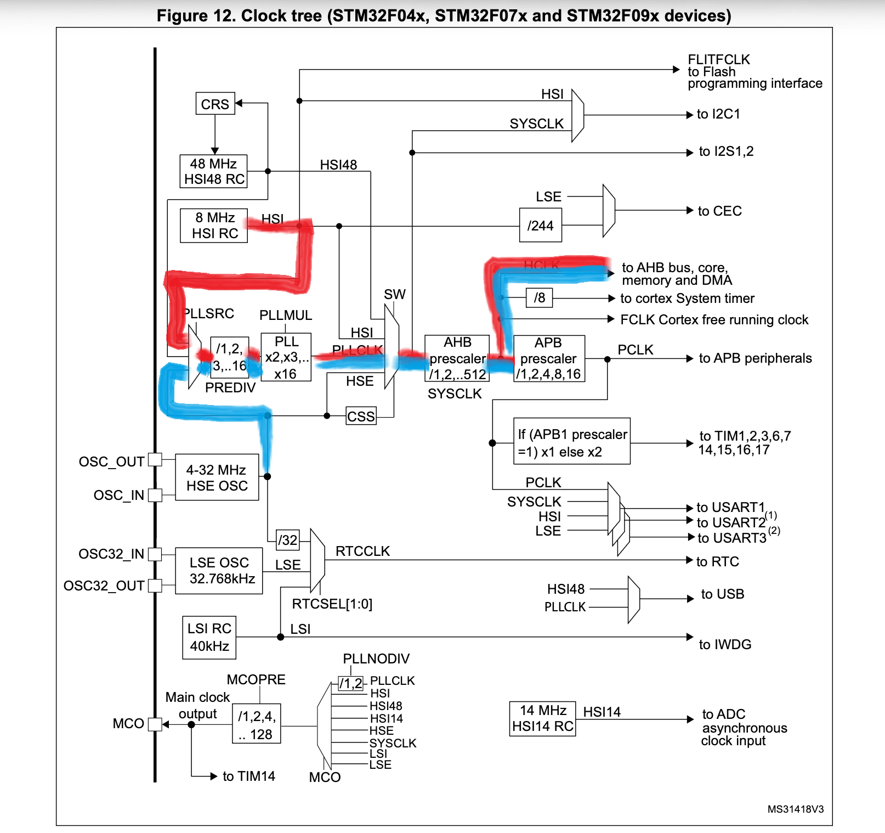

## Übung 3 : Alarmanlage + Taktquelle Dokumentation

### Fragen

#### Was ändert sich mit der neu eingestellten Frequenz? Warum?

Die Clockfrequenz wurde von 48Mhz auf 24Mhz verringert, das hat zur Folge dass die LEDs halb so schnell blinken, und die delay-Zeiten intern (von 200ms auf 400ms) somit doppelt so lang sind. Das heißt das ganze System agiert dann mit halber Geschwindigkeit.

#### Mit welcher Frequenz wird der Prozessor betrieben, wenn das Hauptprogramm gestartet wird. Prüfen Sie also, welche Initialisierung im Startup-Code durchgeführt wird. Beschreiben Sie die einzelnen Schritte im Detail und kennzeichnen Sie den Takt-Pfad in der Takt-Übersichtsgrafik (siehe Seite 104 im STM32F0x2 Reference Manual). Diese Grafik soll ebenfalls in der Abgabe angefügt werden.

Beim Start von `main()` läuft der Prozessor mit **48 MHz**. Nach dem Reset lädt der Cortex-M0 den Stackpointer und springt in den `Reset_Handler` (`startup_stm32f072.s`). Dieser ruft `SystemInit()` auf. `SystemInit()` setzt die RCC-Register auf den Grundzustand zurück (HSI an, PLL/HSE aus, Prescaler auf 1) und ruft anschließend `SetSysClock()` auf. Dort wird zuerst der externe 8 MHz Quarz (HSE) gestartet. Danach werden 1 Flash-Wait-State eingestellt und der Prefetch-Buffer aktiviert. Die PLL wird mit HSE/1 · 6 = 48 MHz konfiguriert, eingeschaltet und als Systemtakt ausgewählt. AHB- und APB-Prescaler bleiben auf 1, also SYSCLK = HCLK = PCLK = 48 MHz. Anschließend initialisiert `__main` die C-Laufzeitumgebung und ruft `main()` auf. Takt-Pfad in der Grafik: HSE → PREDIV (/1) → PLL (×6) → SW (PLLCLK) → SYSCLK → AHB (/1) → HCLK → APB (/1) → PCLK.

### Code-Doku

Für die Implementierung werden die Module board_led.h und board_button.h verwendet. Diese beinhalten Funktionen zum ansteuern der LEDs und zum Abfragen der Taster. In der Main befindet sich eine endlose While, diese fragt konstant den Zustand der Buttons ab mittels Button_GetState(). Diese Funktion gibt mir den Zustand so zurück, dass jeder Button ein Bit dieses uint32_t Typs darstellt, d.h. Bit 0 ist Button_User0, Bit 1 ist Button_User1 und Bit 2 ist Button_WakeUp. Die Bits frage ich dann einzeln mit der ebenfalls von dem Modul bereitgestellten Bitmasken ab.

Wenn ein Alarm ausgelöst wurde, setze ich ein bool auf true das nach den Taster-Abfragen geprüft wird, und die LED3 blinken lässt. 

Wenn der WakeUp-Button gedrückt wird, werden die beiden Alarmzonen-LEDs ausgeschaltet und das Alarm bool zurückgesetzt. Außerdem wird die SysClk einmalig, wie die Angabe verlangt, auf 24Mhz gestellt.

Für die Konfiguration der Clock wird die HSI verwendet. Um das PLL einzustellen, muss dieses vorher deaktiviert werden und anschließend gesetzt werden. Dafür wird der 8Mhz Takt zunächst durch 2 dividiert und anschließend mit 6 multipliziert werden, um auf 24Mhz zu kommen.
